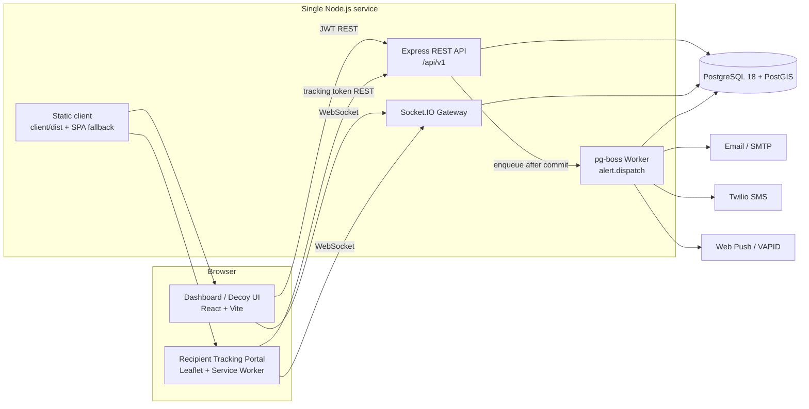
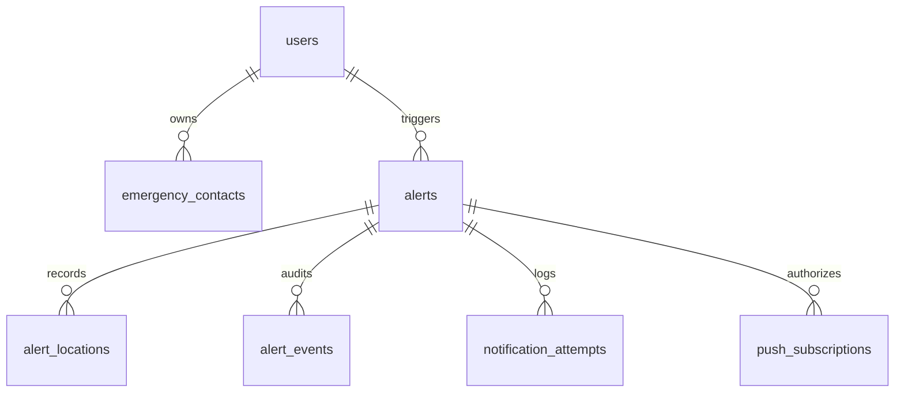

# Silent SOS — Detailed Project Report

| | |
| --- | --- |
| **Project** | Silent SOS Emergency Web App |
| **Program** | UnifiedMentor Internship |
| **Repository** | <https://github.com/manidheeraj-edansamuel/silent-sos-web-app> |
| **Stack** | React 19 + Vite 6, Node.js 22 + Express 4, PostgreSQL 18 + PostGIS, Socket.IO, pg-boss |
| **Status** | Feature-complete through Phase E (production hardening); 119 automated tests passing across 16 suites |
| **Report date** | 27 October 2026 |

---

## 1. Executive summary

Silent SOS is a safety-focused web application that lets a person raise an emergency alert **without speaking or making an obvious call**. The user prepares an account and a list of trusted emergency contacts in advance. In a dangerous situation they trigger an alert silently — from the dashboard, from a disguised calculator/notes decoy, or with a global panic hotkey — and the app streams their live location to a private tracking link that recipients can open on any device.

The system is built as a single Node.js service serving a React single-page application, a real-time Socket.IO gateway, and an in-process notification worker, backed by PostgreSQL with PostGIS for geospatial storage. Every alert, location breadcrumb, notification attempt, and resolution is persisted and auditable. Recipient access is controlled by high-entropy tracking tokens that are stored only as SHA-256 hashes, and the public tracking view deliberately omits personal data.

The project was delivered incrementally in approved phases: foundation and authentication, geospatial alert lifecycle, real-time recipient tracking, asynchronous multi-channel notifications, stealth mode, and production hardening. Each phase was verified with live end-to-end checks and committed separately. The final suite passes 119 tests across 16 suites, the production build succeeds, and the application has been exercised end to end against a managed Neon PostgreSQL instance (PostgreSQL 18.6 + PostGIS 3.6.4).

---

## 2. Problem statement

Existing emergency tools assume the person in danger can speak on the phone, unlock a device openly, or be seen using an app. In domestic abuse, stalking, kidnapping, medical emergencies, and other high-risk situations those assumptions fail. A person may need to:

- send for help **without making a sound**,
- avoid an attacker noticing that help was requested,
- keep trusted people informed of their **live location** while moving,
- have the alert work even if one notification channel fails.

Most consumer SOS apps are native, closed, and tied to one platform. A web application is installable-free, reachable from any phone browser, and can be demonstrated end to end by a recipient who only has a link.

---

## 3. Objectives and scope

**Objectives**

1. Allow a user to register, authenticate, and maintain a prioritized list of emergency contacts.
2. Trigger an alert silently, with the best available location, in a handful of taps or one keystroke.
3. Continuously record GPS breadcrumbs while the alert is active and expose them as a live map.
4. Let trusted recipients follow the alert through an unguessable, revocable-by-expiry public link.
5. Notify contacts asynchronously over email, SMS, and Web Push without delaying the alert itself.
6. Disguise the application behind a harmless-looking decoy so triggering it is not obvious.
7. Harden the service for public HTTPS deployment and prove the full flow against a managed database.

**Out of scope (documented limitations)**

- Replacing official emergency services (911/112).
- Guaranteed delivery latency for SMS/email/push, which depends on carriers and providers.
- Reliable background GPS after the browser tab is closed or suspended.
- Native mobile applications, offline-first queuing (PWA), and production provider webhooks.

---

## 4. Key features

### 4.1 Accounts and emergency contacts
- Email/password registration and login with **Argon2id** password hashing.
- Minimal-claim JWT access tokens; logout endpoint; profile endpoint.
- Full CRUD for emergency contacts with per-contact priority ordering maintained transactionally.
- Per-contact channel preferences (`notify_email`, `notify_sms`) and optional email/phone.
- Strict tenant isolation: every contact, alert, and receipt query is scoped to the authenticated owner.

### 4.2 Silent alert lifecycle
- `POST /alerts/trigger` creates an alert with a snapshot of the triggering location and a fallback when GPS is unavailable.
- Trigger sources are audited: `dashboard`, `stealth_pin`, `panic_hotkey`.
- Location breadcrumbs stream into `alert_locations` as PostGIS `geography(Point, 4326)` rows.
- Active alert restoration (`GET /alerts/active`) so a phone can resume after a reload.
- Resolution with a reason, idempotent by design, recorded in `alert_events`.

### 4.3 Recipient tracking
- Public tracking link containing a 192-bit base64url token; the database stores only its SHA-256 hash.
- Public view shows victim display name, status, latest location, and chronological breadcrumb history.
- Resolved alerts remain readable for a configurable safety window (default 24 hours), then expire.
- Interactive Leaflet map with live Socket.IO updates, accuracy circles, and resolution handling.
- Recipient privacy: no user IDs, token hashes, emails, phone numbers, or credentials are exposed.

### 4.4 Real-time gateway
- Socket.IO rooms are scoped per alert (`alert:<id>`) and joined only with a valid token or authenticated owner.
- No global broadcasts; disconnect and reconnect are handled gracefully.
- Live location and resolution events update both the owner dashboard and recipient portal.

### 4.5 Asynchronous notifications
- pg-boss queue (`alert.dispatch`) enqueued **after** the alert transaction commits, with retry and backoff.
- **Email** via nodemailer (SMTP in production, JSON transport in development) including private tracking links.
- **SMS** via Twilio REST with E.164 normalization and graceful skip when unconfigured.
- **Web Push** with VAPID keys, a service worker, alert-scoped subscriptions, AES-256-GCM encrypted tracking tokens at rest, throttled location pushes, and a final resolution push.
- Per-attempt delivery ledger with **masked destinations**, surfaced to the alert owner as per-channel receipts.

### 4.6 Stealth mode
- Dashboard can be disguised as a working calculator and notes app with a neutral light theme.
- A user-defined 4–8 digit PIN is hashed with SHA-256 **in the browser** and stored only in local storage; it is never transmitted.
- Typing the PIN followed by `=` triggers SOS silently; `Ctrl+Shift+X` triggers from anywhere.
- Discreet exit using a two-second header hold or `Ctrl+Shift+E`.

### 4.7 Hardening and deployment
- 64 KB request body limits, `X-Powered-By` removed, `Cache-Control: no-store` on `/api`, `helmet` security headers.
- Rate limiting on authentication, public tracking, and push configuration.
- Tracking tokens redacted from HTTP logs.
- Managed `DATABASE_URL` with automatic TLS, reverse-proxy trust, hosted-origin allowlisting, and a Render blueprint.
- Single-service deployment: Express serves the built client with an SPA fallback and a CSP that permits map tiles and WebSockets.

---

## 5. System architecture



### Alert lifecycle

1. The owner triggers an alert. The API writes `alerts`, an initial `alert_locations` row, and an `alert_events` row in one transaction.
2. After commit, a pg-boss job is enqueued. The HTTP response never waits for providers.
3. The worker resolves contacts and their channel preferences, then attempts email, SMS, and push, writing one masked `notification_attempts` row per attempt and a summary event without recipient data.
4. The browser streams breadcrumbs; each is stored spatially and emitted to the alert room. Push notifications are throttled.
5. Recipients open the tracking link, see the map and history, and may opt into push notifications.
6. The owner resolves the alert; a final event and push are emitted, and the public view switches to `resolved`.

### Design decisions

- **One long-lived process, not serverless.** Socket.IO connections and the pg-boss worker require a persistent process; the client build is served by the same Express app, so deployment is one service plus one database.
- **PostgreSQL as the system of record and queue.** pg-boss stores jobs in Postgres, avoiding a second infrastructure dependency while still decoupling notification latency from the SOS request.
- **Hash-only tracking tokens.** The database cannot reconstruct a tracking link; a leak of `alerts` does not leak recipient access.
- **Privacy by construction in the recipient payload.** The query selects only display-safe columns, and per-attempt ledgers store masked destinations.

---

## 6. Technology stack

| Layer | Choice | Why |
| --- | --- | --- |
| Frontend | React 19, Vite 6 | Fast build, component model for a stateful emergency UI |
| Mapping | Leaflet + OpenStreetMap tiles | No API key, works on free hosting, CSP allowlisted |
| Real time | Socket.IO 4 | Rooms, reconnection, and fallbacks over WebSocket |
| API | Node.js 22 + Express 4 | Same language as the client, mature middleware ecosystem |
| Database | PostgreSQL 18 + PostGIS | Relational integrity plus spatial types and indexing |
| Queue | pg-boss | Transactional enqueue with retries, no extra broker |
| Auth | Argon2id + JWT | Memory-hard password hashing; stateless API authorization |
| Email | nodemailer | SMTP portability; JSON transport for development |
| SMS | Twilio REST | Widely available, simple HTTPS API |
| Push | web-push + VAPID + service worker | Standards-based browser push without vendor SDKs |
| Tests | Node test runner + fetch/Socket.IO clients | Fast integration tests against real HTTP and real Postgres |
| Hosting | Render + Neon (blueprint included) | HTTPS, long-lived process, managed PostGIS |

---

## 7. Data model

| Table | Purpose | Notable columns |
| --- | --- | --- |
| `users` | Accounts | `email` (unique), `password_hash` (Argon2id), `display_name`, `last_login_at` |
| `emergency_contacts` | Trusted recipients | `priority`, `email`, `phone`, `notify_email`, `notify_sms` |
| `alerts` | Alert lifecycle | `status`, `trigger_source`, `tracking_token_hash`, `triggered_at`, `resolved_at`, `resolution_reason` |
| `alert_locations` | GPS breadcrumbs | `location geography(Point,4326)`, `accuracy_meters`, `logged_at` |
| `alert_events` | Audit trail | `event_type`, `metadata` (no recipient addresses or tokens) |
| `notification_attempts` | Delivery ledger | `channel`, `status`, masked `destination`, `created_at` |
| `push_subscriptions` | Browser push endpoints | endpoint, keys, `tracking_token_encrypted` (AES-256-GCM) |
| `schema_migrations` | Migration bookkeeping | 11 applied migrations, in order |



Migrations `001`–`011` are deterministic and idempotent. `001` enables PostGIS and `pgcrypto`; later migrations add authentication, tracking-token hashing, push subscriptions, and per-contact channel preferences.

---

## 8. API surface (`/api/v1`)

| Method | Path | Auth | Purpose |
| --- | --- | --- | --- |
| GET | `/health` | Public | Service, database, and queue diagnostics |
| POST | `/auth/register` | Public | Create account |
| POST | `/auth/login` | Public | Issue JWT |
| GET | `/auth/me` | JWT | Current profile |
| POST | `/auth/logout` | JWT | End session |
| GET/POST | `/contacts` | JWT | List / create contacts |
| GET/PUT/DELETE | `/contacts/:id` | JWT | Read / update / delete contact |
| POST | `/alerts/trigger` | JWT | Create alert with initial location |
| POST | `/alerts/:id/location` | JWT | Append location breadcrumb |
| POST | `/alerts/:id/resolve` | JWT | Resolve alert (idempotent) |
| GET | `/alerts/active` | JWT | Restore active alert |
| GET | `/alerts/:id/notifications` | JWT | Delivery receipts |
| GET | `/alerts/track/:token` | Token | Public recipient tracking view |
| GET | `/alerts/push/config` | Public, rate-limited | VAPID public key only |
| POST/DELETE | `/alerts/track/:token/push-subscriptions` | Token | Opt in / out of push |

Socket.IO authenticates with a JWT or tracking token, joins only the matching `alert:<id>` room, and emits location and resolution events.

---

## 9. Security and privacy design

- **Password storage:** Argon2id with per-password salts; no plaintext or reversible storage.
- **Authorization tokens:** minimal-claim JWTs signed with a server secret; short-lived and rejected when malformed.
- **Multi-tenant isolation:** every contact, alert, event, and receipt query includes the authenticated user ID; cross-tenant access returns 404 rather than leaking existence.
- **Tracking links:** 192 bits of entropy, base64url encoded, stored as SHA-256; compared by indexed hash. Expired/resolved windows enforced server-side.
- **Recipient data minimization:** public tracking responses exclude user IDs, hashes, emails, phones, and credentials; delivery ledgers store masked destinations; audit metadata stores counts and contact IDs only.
- **Push privacy:** subscription rows encrypt the tracking token with AES-256-GCM so click-through works without plaintext tokens at rest.
- **Stealth:** the PIN exists only as a SHA-256 hash in browser local storage and is never sent to the server; trigger source is audited without the PIN.
- **Transport and headers:** `helmet`, 64 KB body limits, no `X-Powered-By`, `no-store` on APIs, CORS and Socket.IO origin allowlists, proxy-aware rate limiting.
- **Log hygiene:** tracking tokens are redacted from request logs; provider errors are sanitized before storage or display.

---

## 10. Reliability and safety behaviour

- Alerts persist even if no notification provider is configured; the UI reports skipped attempts honestly instead of pretending delivery.
- Notification failures are retried by the queue with backoff and never block the SOS response.
- GPS denial, missing coordinates, WebSocket loss, database errors, and stale push endpoints all degrade gracefully.
- Queue depth and per-channel availability are visible in `/health`, so operators can detect degraded delivery.
- Resolution is idempotent and time-bounded; resolved tracking links expire on a configurable window.

---

## 11. Testing and verification

### Automated tests

`npm test` runs the integration suite against a real PostgreSQL instance.

```
tests 119
suites 16
pass 119
fail 0
skipped 0
duration 10.0s
```

| Suite | What it verifies |
| --- | --- |
| Health | Endpoint contract, database and queue reporting |
| Database | Schema, PostGIS types, migration state, constraints |
| Security | Argon2id hashing, JWT claims and tamper rejection |
| Auth | Registration, login, profile, logout, rate limiting |
| Contacts | CRUD, priority ordering, tenant isolation |
| Alerts | Trigger, breadcrumbs, active restoration, resolution, audit trail |
| Socket.IO | Token-scoped rooms, live events, unauthorized rejection |
| Dispatch queue | Enqueue-after-commit, retries, worker audit events |
| Email | SMTP/JSON transports, link construction, production gating |
| Web Push | VAPID config, subscriptions, encrypted tokens, throttling |
| SMS | E.164 normalization, skip-when-unconfigured behaviour |
| Delivery receipts | Per-channel counts, masking, tenant isolation |
| Hardening | Headers, payload caps, malformed JSON, 404 privacy, push-config exposure |
| Deployment | TLS resolution, `DATABASE_URL` precedence, origin allowlisting |

### Production build

```
vite v6.4.3 building for production...
✓ 65 modules transformed.
dist/assets/index-Bf6mtFm2.js   450.35 kB │ gzip: 133.94 kB
✓ built in 4.69s
```

### Managed-database end-to-end run

The app was started in production mode against Neon and exercised through the full flow:

- Health: `status: ok`, `database: ok`, `queue: ok`.
- Registered a user, added a contact, triggered an alert, posted two location updates.
- Public tracking returned the victim display name, active status, latest coordinates, and both breadcrumbs.
- Delivery receipts returned one masked, skipped email attempt (no provider configured) — honest reporting, no fabricated success.
- Resolution returned `200` with `resolved_at` set; the public view switched to `resolved` and the active-alert query returned `null`.
- Database inspection: PostgreSQL 18.6, PostGIS 3.6.4, 11 migrations applied, 64-character lowercase SHA-256 tracking hash, event types `triggered`, `location_updated`, `notification_dispatched`, `resolved`.
- Test records were removed after verification.

---

## 12. Deployment

The repository includes `render.yaml` and a step-by-step guide in `docs/deployment.md`.

- **Shape:** one Render web service (Node 22) serving API, Socket.IO, worker, and the built client, plus a managed Neon Postgres/PostGIS database.
- **Build:** `npm run install:all && npm run build`
- **Start:** `npm --prefix server run db:migrate && npm start` (migrations are idempotent on every boot).
- **Health check:** `/api/v1/health`
- **Configuration:** `DATABASE_URL` (direct, non-pooled Neon endpoint), `DATABASE_SSL=true`, generated `JWT_SECRET`, `TRUST_PROXY=1`, optional VAPID/SMTP/Twilio credentials.
- **HTTPS is required** for geolocation and Web Push, which Render provides.

Known free-tier caveats: the Render instance sleeps when idle (first visit takes about a minute), Neon suspends idle compute, and free plans carry no SLA. This is suitable for a coursework demonstration, not for real emergency reliance.

---

## 13. Limitations

- **Not an emergency service.** It does not notify police, fire, or ambulance dispatch.
- **No delivery guarantee.** Email, SMS, and push depend on third-party providers and networks.
- **Browser GPS limits.** Tracking stops if the tab is closed, suspended, or permissions are denied.
- **Provider credentials required** for real external messages; without them attempts are recorded as skipped.
- **Free hosting sleeps**, so a cold start can delay the first request.
- **No offline queue yet**; an alert requires connectivity at trigger time.

---

## 14. Future work

1. PWA installability, offline alert queuing with IndexedDB, and background sync.
2. Production verification of SMTP, Twilio, and Web Push, plus delivery webhooks for true delivery receipts.
3. Push action buttons ("call me", "acknowledge") with owner-side acknowledgement.
4. Multi-device presence, contact escalation policies, and alert auto-escalation timers.
5. End-to-end encrypted location history and short-lived rotating tracking links.
6. Accessibility and localization review for high-stress use.

---

## 15. Learning outcomes

- Designing a privacy-preserving public access mechanism around hashed high-entropy tokens.
- Modelling geospatial telemetry with PostGIS and streaming it over scoped WebSocket rooms.
- Decoupling latency-sensitive user actions from unreliable third-party delivery using a transactional queue.
- Implementing layered security: Argon2id, minimal JWTs, tenant isolation, payload limits, origin allowlists, log redaction.
- Building a disguised safety UI where the decoy must behave like a real tool.
- Shipping a real application end to end: incremental delivery, automated tests, managed database verification, and deployment documentation.

---

## 16. Appendix — running locally

```bash
npm run install:all
cp .env.example .env            # set DATABASE_* and JWT_SECRET
npm run db:init                 # create the local database
npm run db:migrate              # apply migrations 001–011
npm run dev                     # server on :5000, client on :5173
npm test                        # 119 tests
npm run build && npm start      # single-service production mode
```

Key environment variables: `DATABASE_URL` or `DATABASE_*`, `DATABASE_SSL`, `JWT_SECRET`, `PORT`, `CORS_ORIGIN`, `APP_BASE_URL`, `TRUST_PROXY`, `VAPID_*`, `SMTP_*`, `TWILIO_*`.

More detail: [`README.md`](../README.md), [`docs/architecture.md`](architecture.md), [`docs/api_spec.md`](api_spec.md), [`docs/safety_constraints.md`](safety_constraints.md), [`docs/deployment.md`](deployment.md).
