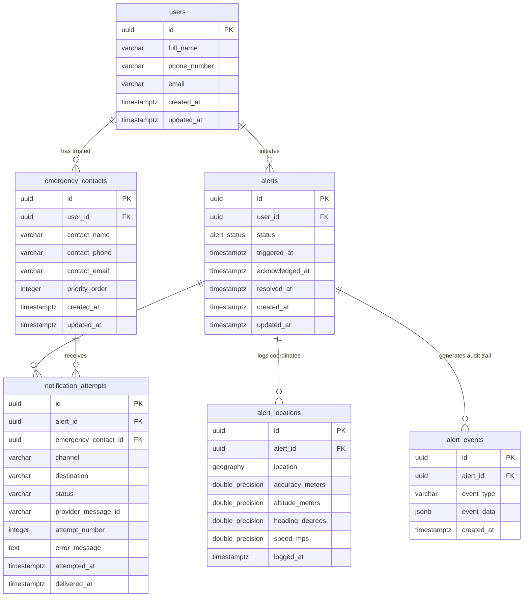

# Silent SOS — Architecture Specification

## 1. System Overview

The **Silent SOS Emergency Web App** provides a covert, fast, and reliable mechanism for individuals in distress to activate an SOS alert and share their location with trusted contacts without alerting nearby individuals through audible sounds.

```
                    ┌─────────────────────────┐
                    │      Client Device      │
                    │   React + Vite (PWA)    │
                    │  Silent Trigger & GPS   │
                    └───────────┬─────────────┘
                                │ HTTPS / WSS
                                ▼
                    ┌─────────────────────────┐
                    │      Backend API        │
                    │ Node.js / Express / v1  │
                    │   Socket.IO Gateway     │
                    └────┬──────┬──────────┬──┘
                         │      │          │
         ┌───────────────┘      │          └────────────────┐
         ▼                      ▼                           ▼
┌──────────────────┐  ┌──────────────────┐        ┌──────────────────┐
│   PostgreSQL +   │  │  Redis Cache &   │        │ Notification Svc │
│     PostGIS      │  │  BullMQ Queue    │        │  (Twilio / SES)  │
│ (Users & Alerts) │  │  (Real-time Pub) │        │  (SMS / Email)   │
└──────────────────┘  └──────────────────┘        └─────────┬────────┘
                                                            │
                                                            ▼
                                                  ┌──────────────────┐
                                                  │ Trusted Contacts │
                                                  │ Tracking Portal  │
                                                  └──────────────────┘
```

---

## 2. Core Subsystems & Incremental Milestones

### Phase 1: Project Initialization (Completed)
- React/Vite frontend skeleton with responsive layout & health dashboard
- Node.js/Express backend baseline with `/api/v1` routing & `/api/v1/health`
- Workspace structure, `.gitignore`, `.env.example`, and baseline verification

### Phase 2: Database & Geospatial Modeling (Current Phase - Completed)
- PostgreSQL 18.6 relational schemas with PostGIS 3.6.2 spatial extension
- Tables: `users`, `emergency_contacts`, `alerts`, `alert_locations`, `alert_events`, `notification_attempts`
- Spatial index: GiST index on `alert_locations (location)`
- Idempotent migration runner (`database/scripts/migrate.js`) with `schema_migrations` tracking
- Development mock seeds (`database/scripts/seed.js`)
- Backend `pg.Pool` connection layer with `/api/v1/health` diagnostic integration

### Phase 3: Authentication & User Profiles (Future Milestone)
- Secure user registration, password hashing (Argon2 / bcrypt), and JWT authentication
- Contact management for trusted individuals (phone numbers, emails, relationship)

### Phase 4: Silent SOS Engine & Real-time Location (Future Milestone)
- Quick silent trigger mechanisms (stealth UI, hotkeys, disguised modes)
- Geolocation capture with fallback handling
- Secure cryptographic tracking token generation (UUIDv4/nanoID)
- Socket.IO gateway for real-time tracking

### Phase 5: Notification Queues & Trusted Contact Portal (Future Milestone)
- BullMQ asynchronous worker pipeline backed by Redis
- Multi-channel notification delivery (SMS via Twilio, Email via SES/SendGrid)
- Dedicated secure tracking view for emergency contacts with Leaflet maps
- Alert acknowledgement, status tracking, and resolution workflow

### Phase 6: PWA, Offline Capabilities & Hardening (Future Milestone)
- Service worker caching, offline capability, installability
- Strict rate limiting, audit logging, and penetration testing verification

---

## 3. Database Entity-Relationship Architecture



---

## 4. Technology Stack

| Layer | Component | Description |
|---|---|---|
| **Frontend** | React 18+, Vite | Fast, modern client-side rendering with SPA/PWA capabilities |
| **Backend** | Node.js, Express.js | High-throughput REST & WebSocket event coordinator |
| **Realtime** | Socket.IO | Bidirectional event transport for live coordinate streaming |
| **Database** | PostgreSQL 18.6 + PostGIS 3.6.2 | ACID transactional integrity with native geographic coordinates & GiST spatial indexing |
| **Queue/Cache** | Redis + BullMQ | Non-blocking background notification queues & active session cache |
| **Mapping** | Leaflet | Lightweight, privacy-respecting client mapping |
| **Security** | Helmet, CORS, JWT | Layered perimeter and session security |
